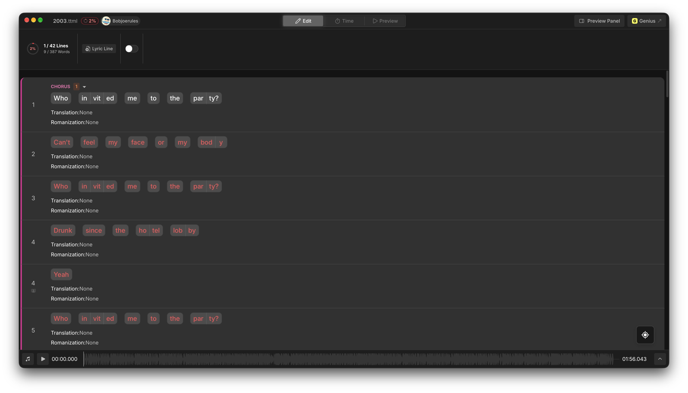
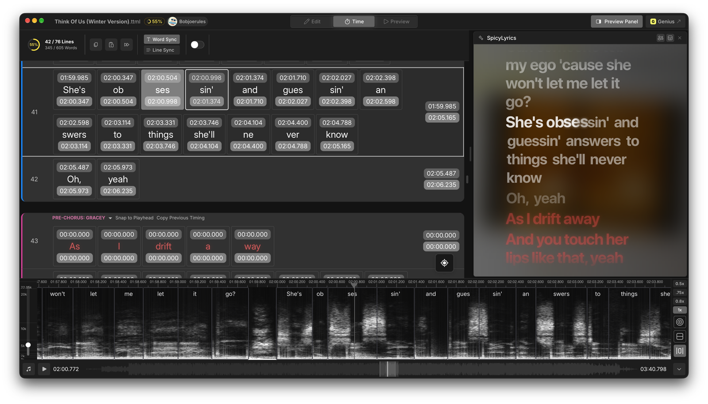
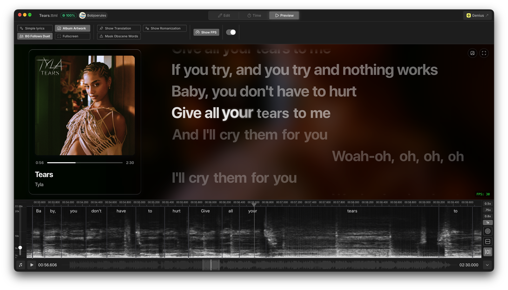

<div align="center">


# TTML Tool

**A desktop editor for word-synced TTML lyrics.**

Made and maintained by **[Rimurulover](https://github.com/rimuruslimetempest)**.

[Download](https://github.com/rimuruslimetempest/AMLL-TTML-TOOL/releases/latest) ·
[Report a problem](https://github.com/rimuruslimetempest/AMLL-TTML-TOOL/issues) ·
[Privacy Policy](./PRIVACY.md) ·
[Terms of Use](./TERMS.md)

</div>

## What it is

TTML Tool is a Windows, macOS, and Linux desktop app for writing and timing
TTML lyric files. It puts the waveform, spectrogram, lyric timeline, and a live
preview in one window so you can place every line, word, and syllable yourself
and immediately see how the result behaves.

Every timestamp is manual. TTML Tool does not invent, move, or retime a lyric
on its own. Importing a file, splitting words, and converting a format are
editing aids; they never decide when a word should be sung.

## Features

### Syncing and editing

- Line-by-line, word-by-word, and syllable-by-syllable timing with a waveform,
  a spectrogram, millisecond fields, and keyboard shortcuts.
- Edit lyric text, translations, romanizations, background vocals, duet lines,
  sections, and song metadata in the same project.
- Undo and redo across timing, text, and structural changes, plus autosaves and
  restore points for recovering earlier work.
- Timing tools for shifting, stretching, and copying timing between lines, with
  a live timing overview.

### Splits and text tools

- A saved split library with previews, proportional timing for words that
  already have timing, and per-word notes.
- Syllable splitting, word replacement, line merging, duplicate cleanup, and
  other text tools that operate on the lyrics you selected.
- A TTML Checklist for keeping a local queue of songs and their progress.
- A song-info panel for writers, languages, streaming IDs, version notes, and a
  copy-ready metadata block.

### Live rooms and collaboration

- Host, Editor, Commenter, and Viewer roles in a live room.
- Shared editing, chat, comments, per-line review marks, history, and restore
  points.
- An optional shared split dictionary so everyone in a room can reuse the same
  word splits.
- Review marks and comments are annotations only: they never change the TTML or
  the timing data.

### Preview

- A live lyric preview with word and line highlighting, background vocals,
  duet layout, translations, and romanization.
- Preview options for Simple lyrics, Show Translation, Show Romanization,
  BG Follows Duet, Album Artwork, Fullscreen, Mask Obscene Words, and Show FPS.
- A stable lyric renderer with word and line highlighting, transform-based
  scrolling, duet layout, and background vocals.
- Performance mode reduces interface effects on slower machines.

### Import and export

- Import TTML, LRC, enhanced LRC, SRT, ASS/SSA dialogue, WebVTT, and plain text.
- A preview before import shows the detected format, the line count, and any
  lines that could not be read.
- Imported timing is marked **needs review**; nothing is retimed or merged.
- Export TTML, LRC, enhanced LRC, SRT, or plain text. The export dialog explains
  what each format cannot carry, such as per-word timing or background vocals.
- Drag a lyric file onto the window to open it. The desktop build registers
  `.ttml`, `.lrc`, and `.srt` files with the operating system.

### Project and song information

- Project metadata for title, artists, album, songwriters, language, cover art,
  and streaming-platform IDs.
- Local project history, autosaves, and restore points.
- Optional cloud library and audio storage for signed-in users.

### Appearance and performance

- Light and dark appearance, UI density and scale, custom accents, fonts, and
  background images.
- Installable themes with light and dark color schemes, a theme manager, a
  token editor, and a separate Custom CSS box. Built-ins include Liquid Glass,
  Glass Dark, Glass Light, AMOLED Black, Midnight Neon, Sakura, Mocha, Latte,
  Nord-style, Dracula-style, Solarized-style, Terminal, Paper, High Contrast,
  and Windows 11 Mica. See [THEMES.md](./THEMES.md).
- A community theme marketplace at
  <https://rimuruslimetempest.github.io/AMLL-TTML-TOOL/>. Browse it in the
  theme manager, or opt in to load the registry inside the app; downloads are
  checked against a published SHA-256 and go through the normal preview.
- Glass effects stay on interface chrome; Performance mode, reduced motion, and
  unsupported hardware use the flat version of each theme.
- Performance mode and appearance controls.
- Discord Rich Presence with customizable text.
- A portable settings and project backup.
- An optional yt-dlp/FFmpeg media downloader on desktop, with a tool version
  check, verified updates, a one-click ffmpeg repair, playlist picking, and
  plain-language errors.
- A 30-day recycle bin for deleted lines, words, saved splits, themes,
  and projects, with restore, restore into another project, and a configurable
  retention period.
- Community translations.

### Updates and first-run setup

- A built-in updater with a daily check, a non-blocking banner, release notes,
  download progress, Stable and Beta channels, and a skip-this-version option.
- A short first-run setup for display name, appearance, audio output, tap key,
  performance mode, and privacy choices. It can be reopened from Settings.

## Theme marketplace

Community themes are listed at
<https://rimuruslimetempest.github.io/AMLL-TTML-TOOL/>. The page is built from
`docs/registry/themes.json`, and every entry has a preview, a SHA-256, a
performance level, and a minimum app version. In the app, **Settings →
Appearance → Themes → Manage themes** can open the page or, if you opt in, show
the same list inside the app. Downloads are checked against the published hash
and still go through the normal theme preview. See [THEMES.md](./THEMES.md) and
[CONTRIBUTING.md](./CONTRIBUTING.md) to submit a theme.

## What is different in this version

TTML Tool keeps the familiar TTML editing workflow and adds:

- **Live rooms with roles and comments.** Host, Editor, Commenter, and Viewer
  roles, room chat, comments, review marks, history, and restore points.
- **Saved personal splits.** A reusable split library with previews and notes,
  plus optional sharing inside a room.
- **A redesigned interface with themes and Performance mode.** Install or make
  a theme with the built-in editor, import and export theme packs, and keep the
  glass effects on the chrome only. Density and scale controls plus a
  lower-effects mode for slower computers.
- **A stable Preview.** Word and line highlighting, transform-based scrolling,
  duet and background-vocal layout, and the Preview options listed above.
- **Extra import and export formats.** LRC, enhanced LRC, SRT, ASS/SSA, WebVTT,
  plain text, and TTML, with a review step before imported timing is trusted.
- **First-run setup and an auto-updater.** A short onboarding wizard and update
  checks that use this repository's GitHub Releases.

## Install

Download the latest release for your system:

| Platform | File |
| --- | --- |
| Windows x64 | `TTML-Tool_1.0.1_x64-setup.exe` (NSIS) or `.msi` |
| macOS Apple Silicon | `TTML-Tool_1.0.1_aarch64.dmg` |
| macOS Intel | `TTML-Tool_1.0.1_x64.dmg` |
| Linux x64 | `TTML-Tool_1.0.1_amd64.AppImage`, `.deb`, or `.rpm` |

Releases built with updater metadata also publish `latest.json`, which the
built-in updater uses. If a release has no updater metadata, installations are
still fully usable and the updater stays quiet. On Linux, the AppImage updates
itself; update `.deb` and `.rpm` packages with your package manager.

### Windows

Run the `.exe` installer, or open the `.msi` with Windows Installer. The
installer creates Start menu and desktop shortcuts and registers `.ttml`,
`.lrc`, and `.srt` files with TTML Tool.

### macOS

Open the `.dmg` for your Mac, drag **TTML Tool** into **Applications**, then
open it from Applications. Choose the Apple Silicon download for an M-series
Mac and the Intel download for an older Intel Mac.

### Linux

The AppImage is a single portable file. Make it executable once, then run it:

```bash
chmod +x TTML-Tool_1.0.1_amd64.AppImage
./TTML-Tool_1.0.1_amd64.AppImage
```

On Debian or Ubuntu, install the `.deb` with `sudo apt install ./TTML-Tool_1.0.1_amd64.deb`.
On Fedora or another RPM-based distribution, use
`sudo dnf install ./TTML-Tool_1.0.1_x86_64.rpm`. The package manager keeps
those installations up to date.

If you are replacing a build that used a different application identifier,
uninstall that build first and export a settings backup before switching. The
operating system keeps the old and new WebView profiles separately, so local
settings are not carried over automatically.

## Build from source

### Requirements

- Node.js 20 LTS or newer and pnpm 10 (`corepack enable`).
- Rust stable with Cargo.
- **Windows:** Visual Studio 2022 Build Tools with Desktop development with
  C++, the Windows SDK, and the WebView2 runtime.
- **macOS:** Xcode Command Line Tools.
- **Linux:** the WebKitGTK 4.1 development packages, GTK 3, libappindicator,
  ALSA headers, `librsvg2`, and `patchelf`.

### Commands

```bash
git clone https://github.com/rimuruslimetempest/AMLL-TTML-TOOL.git
cd AMLL-TTML-TOOL
pnpm install --frozen-lockfile

pnpm dev          # browser development build
pnpm tauri dev    # desktop development build
pnpm build        # production web build
pnpm tauri build  # production desktop bundles
```

Desktop bundles are written under `src-tauri/target/release/bundle/`. Unit tests
run with `pnpm test`.

Cloud features are optional and off until you sign in. For a public deployment,
create your own Firebase project and set the `VITE_FIREBASE_*` values from
[`.env.example`](./.env.example). Do not use another person's Firebase project
without permission.

## Screenshots







## Privacy

The editor is local-first: projects, timing, settings, autosaves, and cached
audio stay on your device unless you use a network feature. Live rooms, cloud
accounts, search and import providers, Discord Rich Presence, and update checks
each have their own data flow, described in the [Privacy Policy](./PRIVACY.md).
Crash reports are off by default.

Privacy and legal contact: **rimurusamllttmltool@gmail.com**.

## Credits

TTML Tool is created and maintained by **Rimurulover**
([GitHub](https://github.com/rimuruslimetempest)).

TTML Tool began from the AMLL TTML Tool codebase; its copyright and license
notices are retained in [LICENSE](./LICENSE) and the source-file headers.
Third-party components, including Spicy Lyrics, SpotMatch, and the Prosodic
syllabification engine, are credited in **Settings → About**.

## License

TTML Tool is distributed under the **GNU Affero General Public License v3.0**.
See [LICENSE](./LICENSE).
